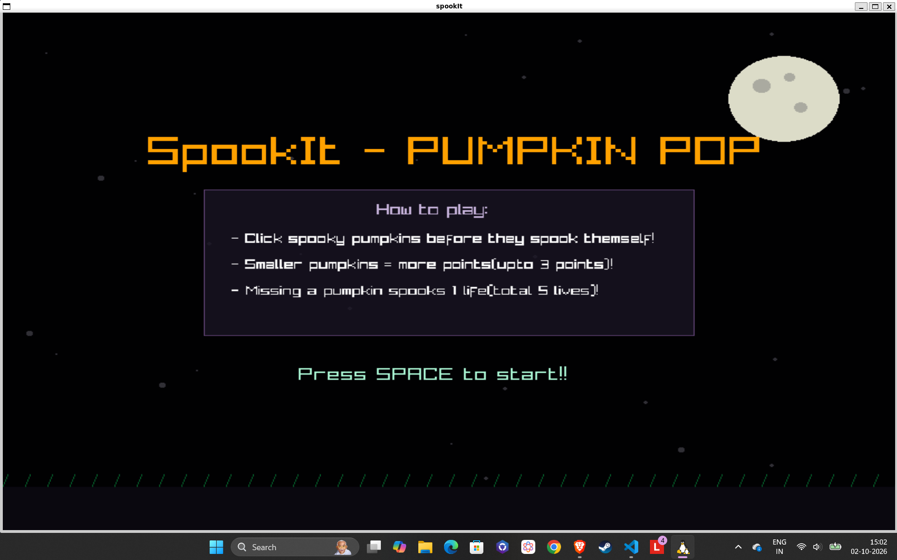
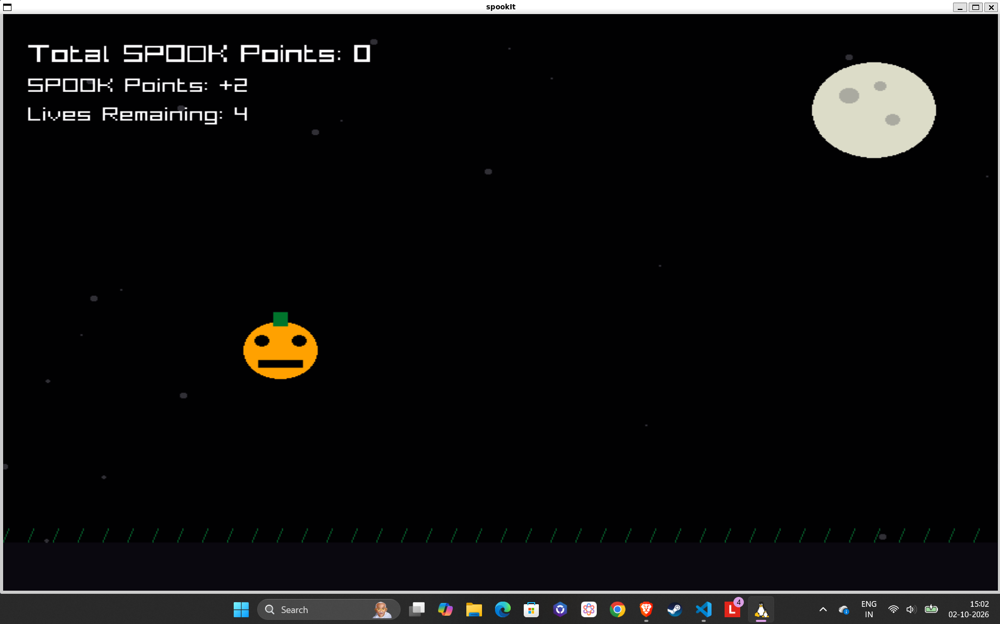

# spookIt (Pumpkin Pop)
> pop spooky pumpkins and score points before they pop themself

## Description 
A Clean, interactive C++ game built from scratch using Raylib Library. Players test their reflexes by clicking on spooky pumpkins that spawn dynamically in time. The game features progressive difficulty, animations, and a night sky aesthetic that is based on a dark and spooky theme.

## Preview



## Features 
1. the code has been divided into various files such as header files and source file, header files for variables and functions, source file for the codebase using the header files, this allows me to use parts of this code in later projects which i might work on. 
2. spookIt can be played in any kind of display mode such as windowed or fullscreen.
3. the difficulty of the game increases the longer the player plays the game in order to make the game more fun and engaging.
4. the visuals in this game are especially designed to match the theme which this game is based on, namely dark and spooky cause of spooktober.
5. this project has helped me learn dive deeper into C++ which would help me get better at game development and also learn more about libraries and frameworks, namely Raylib.

## Technologies & Tools
Language: C++<br>
Library: Raylib<br>
Build System: GNU Make (Makefile)

## How to play spookIt
- Before building spookIt, ensure you have C/C++ compiler and Raylib library installed [https://github.com/raysan5/raylib]
- This game has only been tested on WSL2(Ubuntu 26.04)

### Linux & WSL(Ubuntu/Debian)

1. **Clone the repository:**
   ```bash
   git clone https://github.com/th25thbam/spookIt
   cd spookIt

2. Install Raylib dependencies:
    ```base
    sudo apt update
    sudo apt install build-essential libraylib-dev libgl1-mesa-dev libopenal-dev

3. Compile and run using Makefile
    ```bash
    make run
4. Prebuilt binary files are available in the releases tab for debian based linux distributions

### Windows(MinGW/MSYS2)
1. Clone Repository
2. Install Raylib and GCC using MYSY2:
    ```bash
    pacman -S mingw-w64-ucrt-x86_64-raylib mingw-w64-ucrt-x86_64-gcc
3. Compile manually using g++
    ```bash
    g++ main.cpp functions.cpp globals.cpp -o spookIt.exe -lraylib -lopengl32 -lgdi32 -lwinmm

### macOS(Homebrew)
1. Clone Repository
2. Install Raylib
    ```bash
    brew install rayib
3. Compile manually using g++
    ```bash
    g++ main.cpp functions.cpp globals.cpp -o spookIt -lraylib -framework OpenGL -framework Cocoa -framework IOKit -framework CoreVideo

#### Game controls
1. press space to start playing.
2. mouse left click to pop pumpkins.
3. press R to restart after all lives have been consumed.
4. press Esc to exit.

## Inspiration
i wanted to try making an aim trainer in 2D while keeping it simple and fun, and using visuals that would match the dark and spooky halloween theme of october.


